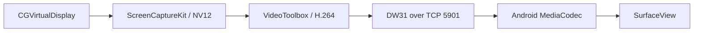

# DeskWeave

**Turn an Android tablet into a wireless extended display for your Mac.**

[](https://www.apple.com/macos/)
[](https://www.android.com/)
[](LICENSE)

DeskWeave is an experimental, open-source pair of native apps. The macOS app
creates and captures a virtual display, encodes it as low-latency H.264, and
streams it over your local Wi-Fi network. The Android app decodes the stream in
hardware and presents it full-screen.

> [!IMPORTANT]
> DeskWeave uses the private macOS `CGVirtualDisplay` API because Apple does
> not provide a public API for creating a software display. It may stop working
> after a macOS update and is not suitable for Mac App Store distribution.

> [!WARNING]
> The current protocol is not encrypted or authenticated. Use DeskWeave only
> on a trusted private network. Do not expose TCP port `5901` to the internet.

[Português do Brasil](README.pt-BR.md)

## Features

- true extended macOS desktop, not simple mirroring;
- 1792 × 1120 virtual display at up to 60 fps;
- hardware H.264 Main Profile Level 4.2 encoding with VideoToolbox;
- hardware H.264 decoding with Android MediaCodec;
- low-latency bounded frame queue and keyframe recovery;
- automatic local IPv4 address discovery;
- no accounts, cloud service, analytics, or telemetry;
- native Swift/SwiftUI and Java applications.

## Requirements

### Mac

- Apple Silicon Mac;
- macOS 15 or newer;
- Screen Recording and Local Network permissions;
- Xcode Command Line Tools when building from source.

### Android tablet

- Android 8.0 / API 26 or newer;
- hardware H.264 decoder capable of 1792 × 1120 at 60 fps;
- Java 17 and Android SDK 36 when building from source.

Both devices must be connected to the same trusted Wi-Fi network. Guest Wi-Fi
networks often block communication between devices.

## Repository layout

```text
DeskWeave/
├── macOS/DeskWeaveMac/       # Swift Package and macOS app bundle script
├── android/DeskWeaveAndroid/ # Android Gradle project
├── docs/                     # Architecture, build and troubleshooting docs
└── .github/                  # CI and contribution templates
```

## Build from source

### macOS app

```zsh
cd macOS/DeskWeaveMac
./build-app.sh
```

The ad-hoc signed application is generated at:

```text
macOS/DeskWeaveMac/dist/DeskWeave.app
```

Move it to `/Applications`, open it, and grant Screen Recording access when
macOS asks. See [Building](docs/BUILDING.md) for details.

### Android app

```zsh
cd android/DeskWeaveAndroid
./gradlew assembleDebug
```

The APK is generated at:

```text
android/DeskWeaveAndroid/app/build/outputs/apk/debug/app-debug.apk
```

Install it with Android Studio or `adb install -r app-debug.apk`.

## Use DeskWeave

1. Open DeskWeave on the Mac.
2. Click **Create second display**.
3. Grant Screen Recording permission if requested, then start it again.
4. Open DeskWeave on the Android tablet.
5. Enter one of the addresses shown by the Mac, including `:5901`.
6. Tap **Connect**.
7. Arrange the new display in **System Settings → Displays** and drag a window
   onto it.

Tap the tablet screen to show or hide connection statistics.

## How it works



See [Architecture](docs/ARCHITECTURE.md) for the stream format, backpressure
behavior, and component responsibilities.

## Known limitations

- Wi-Fi only; USB transport is intentionally excluded from this public release.
- No audio or touch input.
- No encryption, authentication, or device pairing yet.
- The virtual display disappears when the Mac app closes.
- Static desktops may report a low FPS because ScreenCaptureKit sends frames
  when content changes.
- Private macOS APIs can change without notice.
- The provided build is ad-hoc signed and not notarized.

## Contributing

Bug reports, device compatibility results, documentation fixes, and focused
pull requests are welcome. Read [CONTRIBUTING.md](CONTRIBUTING.md) and
[SECURITY.md](SECURITY.md) before opening an issue. See [PRIVACY.md](PRIVACY.md)
for the data-handling summary and [CHANGELOG.md](CHANGELOG.md) for releases.

## License

DeskWeave is available under the [MIT License](LICENSE).
